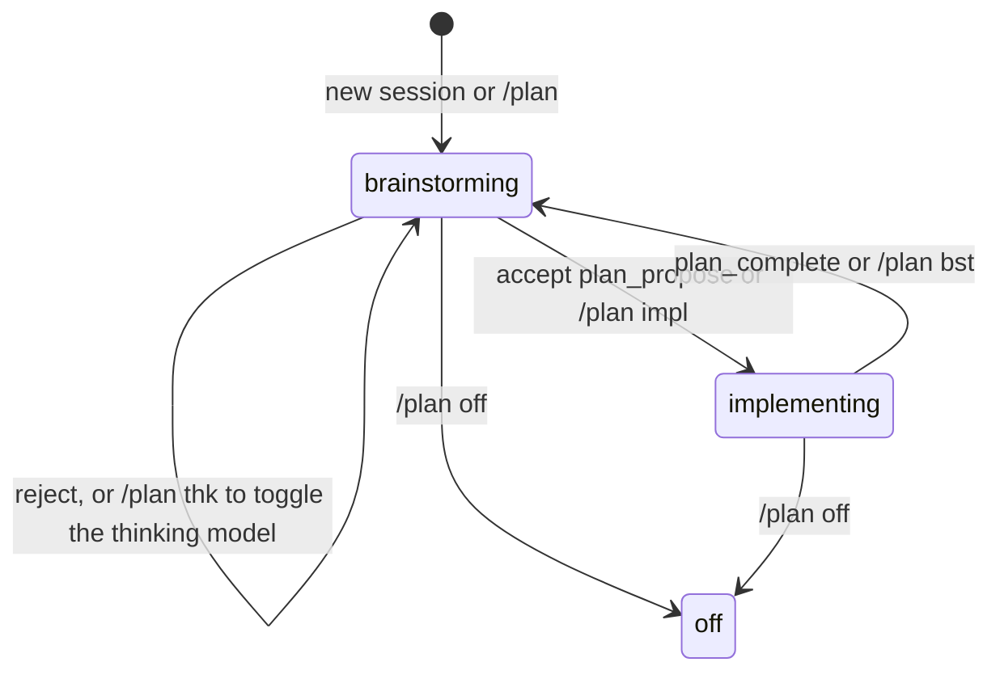

# pi-plan-mode

Plan mode for the [pi coding agent](https://github.com/earendil-works/pi).

It separates repository discovery from implementation:

- **Brainstorming**: inspect the project and prepare a proposal.
- **Implementing**: available after the user accepts the proposal.



## Workflow

The agent uses three control tools:

- `plan_ask` — ask choice questions before proposing.
- `plan_propose` — submit one complete proposal for review, including the changes and any tests worth adding.
- `plan_complete` — finish an accepted implementation and return to brainstorming for the next cycle; it never turns plan mode off.

The control tools are `model-only`, so `codemode` scripts cannot call them.

A proposal contains:

1. A short description.
2. A list of changes, one per file or area, with a small concrete example where it helps.
3. Tests worth adding or updating, only when they make sense: they must cover real behavior rather than restate existing coverage.

In a UI session, the user can accept and implement, or reject. Closing the review without a choice also rejects. After a rejection, the agent waits for feedback before asking questions or submitting another proposal. Any message you send after a rejection counts as that feedback and lets the agent continue. `/plan bst` works the same way during implementation.

The plan phase follows the session tree: navigating to another branch restores the phase and tools that branch had.

## Commands

| State         | Command      | Result                                                                                                                       |
| ------------- | ------------ | ---------------------------------------------------------------------------------------------------------------------------- |
| Off           | `/plan`      | Enter brainstorming.                                                                                                         |
| Brainstorming | `/plan thk`  | Toggle the thinking model on or off. Tools and the deny list stay the same.                                                  |
| Brainstorming | `/plan impl` | Accept the stored proposal and start implementing, without the review dialog.                                                |
| Implementing  | `/plan bst`  | Stop implementing and return to brainstorming. The proposal is kept for `/plan impl`, and the agent waits for your feedback. |
| Enabled       | `/plan off`  | Exit plan mode and restore the original tools; this is the only way to turn it off.                                          |

## Permissions

During brainstorming, plan mode denies these tools by default:

- `bash` and `powershell`
- `edit` and `write`

A denied tool is removed from the active tools, and every call to it is blocked, also when a `codemode` script makes the call. All other tools stay available, together with `read`, `grep`, `ls`, and `find`, which plan mode adds for discovery. The plan control tools are `model-only`: the model calls them directly, and `codemode` scripts cannot call them.

After acceptance, the saved tools are restored together with `plan_complete`. When the agent completes the implementation, `plan_complete` returns it to brainstorming and clears the proposal; only `/plan off` exits plan mode.

## Configuration

Plan mode reads `~/.pi/agent/plan.json` (the pi agent folder, where `mcp.json` lives):

```json
{
    "modes": {
        "brainstorming": {
            "model": "openai/gpt-5-mini",
            "deniedTools": ["mcp__agent_browser__agent_browser_click", "mcp__k8s__*"]
        },
        "thinking": {
            "model": "anthropic/claude-opus-4-1"
        },
        "implementing": {
            "model": "openai/gpt-5"
        }
    }
}
```

### Deny list

- `modes.brainstorming.deniedTools` adds tools to the default deny list. You cannot remove a default.
- Entries match a tool name exactly, or as a prefix when the entry ends with `*`. A bare `*` is ignored with a warning, because it would deny every tool. The plan control tools are never denied.
- MCP tools are named `mcp__<server>__<tool>`, with `-` in the server name written as `_`: the server `agent-browser` becomes `mcp__agent_browser__*`.
- The deny list works for every exposure. Tools on the default `codemode` exposure are reached through `codemode` scripts, and plan mode blocks a denied one there too.
- A deny list allows what it does not name. When you add an MCP server, deny its write tools.

### Models

- `modes.<phase>.model` is `provider/id`. Plan mode splits it on the first `/`, so an id can contain a slash: `bifrost-openai/Huawei/deepseek-v4-pro`.
- When a phase starts, plan mode switches to the model of that phase. A phase without a model uses the model you had before plan mode.
- Plan mode saves your model before the first switch, and `/plan off` restores it.
- `/plan thk` toggles brainstorming between its model and `modes.thinking.model`, for example a cheap model to explore and a stronger one to design. It is available only during brainstorming, keeps the same tools and deny list, and shows `plan: thinking` in the status. Thinking turns off when brainstorming ends. Without `modes.thinking.model`, `/plan thk` gives a warning and changes nothing.
- A model you pick with `/model` stays until the next phase change.
- An unknown model, or a model without credentials, gives a warning. The phase still changes, and the current model stays.

The file is read when a session starts. Restart the session or run `/reload` after editing it. A missing or empty file means no configuration, and every bad value is reported as a warning and ignored. The old `allowedTools` key is no longer supported and is reported.

## Install

```bash
pi install git:github.com/phrmendes/pi-plan-mode
```

## Development

```bash
pnpm install
pnpm test
pnpm test:e2e
pnpm run typecheck
pnpm run format:check
pnpm run pack:check
```

Before release, test acceptance, rejection, reload, resume, non-UI submission, and completion in a real pi session.

## License

Apache-2.0. See [LICENSE](./LICENSE).
